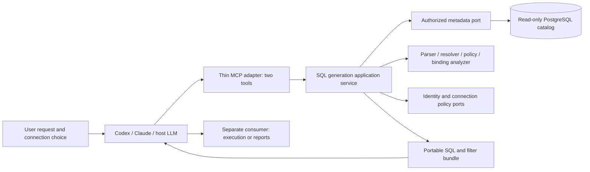

# Atlas SQL-generation MCP specification

> [Connection strings](connection-strings.md) are now supported by `atlas_sql_connect`.
> This supersedes the original prohibition on caller-provided credentials and
> removes the requirement for a preconfigured connection file.

> Update: [optional LangChain generation](langchain-generation.md) supersedes the
> original host-only/two-tool restriction when `ATLAS_SQL_MODEL` is configured.
> Catalog-only database access and deterministic validation remain unchanged.

Current extension: [experimental SQL Server support](sqlserver-support.md) adds a separate dialect adapter and contract 1.1 while preserving PostgreSQL contract 1.0. The original PostgreSQL requirements below remain the baseline; SQL Server native/ODBC certification is still open.
**Status:** target contract with an implemented supported subset. **Decisions confirmed:** 26 October 2026. This specification describes the standalone SQL-generation service. The [package guide](../README.md) and exported schemas document current runtime behavior.

**Implementation coverage:** a separately installable [SQL MCP package](../README.md) now implements the two-tool workflow with native PostgreSQL parsing, scoped analysis, typed filters, authorized catalog access and isolated parser budgets. [The parser decision](sql-mcp-parser-decision.md) records the Python runtime choice. The package guide and exported schemas define actual supported-subset behavior; views, some type/overload cases, nullable parameters, real client/model evaluations, performance percentiles and reporting-consumer migration remain target work. The requirements below are not a claim that every release gate is complete.

The requirement is a reusable natural-language-to-SQL capability: a user supplies a request and an authorized PostgreSQL connection; their assistant uses database context to produce SQL and a complete filter contract. Codex, Claude, or another MCP host supplies the LLM. Atlas supplies database knowledge, deterministic checks, and the final portable artifact. Report persistence and execution belong to consumers of this core.

## 1. Executive Summary

### Problem statement

The existing reporting workflow combines database discovery, a restricted query definition, report management, and execution. An assistant that only needs an advanced SQL query should not need a report lifecycle, a browser, or a proprietary single-source definition language.

### Proposed solution

Build an independently usable MCP service whose sole responsibility is to help a host LLM construct and validate PostgreSQL analytical SQL. It returns SQL, typed parameters, an array of filters, result metadata, dependencies, business assumptions, and explicit validation evidence without running the generated query.

“As capable as an experienced DBA” is a quality ambition, not a guarantee that arbitrary SQL is safe, semantically correct, or efficient. The target supports complex analytical queries, including representative queries exceeding 1,000 lines. It does not grant permission to modify a database. Correctness must be demonstrated against reference results and disclosed assumptions, rather than inferred from query length or fluent explanations.

### Success criteria

The following are release gates, not results already measured:

1. Complete request → authorized context → host-generated SQL → validated artifact in Codex and Claude Code, with no model provider configured inside Atlas and no report, frontend, or report metadata database required.
2. Pass a versioned corpus of at least 120 cases, including at least 80 supported analytical cases and 40 negative or ambiguous cases. Every accepted supported query must match independently defined reference results when executed by the test harness. Every negative case must be rejected or require clarification as specified by its expected outcome.
3. Achieve at least 90% successful host orchestration on unambiguous supported natural-language cases across three runs per supported client/model configuration. Report failures, model/client versions, token use, and success criteria; do not average away unsafe acceptances.
4. Accept a meaningful query of at least 1,000 lines with joins, CTEs, windows, calculations, and aggregation. Return its entire artifact without truncation. Prove that generation makes zero business-data queries and zero destination writes.
5. On the declared benchmark environment, target p95 ≤ 1 second for a focused context page and ≤ 3 seconds for finalization of the large-query fixture at 10 concurrent requests. Publish catalog size, hardware, cold/warm behavior, timeouts, and model time separately. Failure to meet these targets requires documented changes or an explicit release decision.

## 2. User Experience & Functionality

### Personas, stories, and acceptance criteria

| Persona and story | Acceptance criteria |
|---|---|
| Analyst: “As an analyst, I want to describe a question in my assistant so that I receive SQL I can understand and reuse.” | Receives a complete artifact, understandable explanation, filters, output columns, assumptions, and validation status; no report must be created. |
| Developer: “As a developer, I want SQL and typed filters so that my application can bind values safely.” | Can build a filter form and bind native PostgreSQL parameters from the artifact alone; no parsing of prose or interpolating values into SQL. |
| DBA: “As a DBA, I want advanced query support so that complex analysis does not require simplifying the business question.” | Can use governed joins, CTEs, nested queries, window functions, calculations, and set operations within published capabilities; receives precise unsupported-feature errors. |
| Data owner: “As a data owner, I want query construction to respect access and business definitions.” | Context and finalization enforce the caller's current connection, relation, column, function, and disclosure permissions, including dependencies hidden behind views. |
| Integrator: “As an integrator, I want an independent MCP core so that I can use it without Atlas reports.” | Starts with approved connection configuration and identity; neither a report ID nor destination installation is needed. |

### Primary interaction

1. The user asks, for example: “Show monthly net revenue, customer ranking, and growth against the prior month, excluding canceled orders.” They select an authorized connection in their client or connection configuration.
2. The host calls `atlas_sql_context_get` with the request and connection reference. Atlas returns authorized discovery context, capabilities, metadata provenance, clock/timezone, and an expiring context handle.
3. The host uses further calls to the same tool to request focused tables, column details, relationships, or business definitions. Large catalogs are paginated and searchable; a partial page never claims to describe the entire database.
4. The host resolves genuine ambiguity with the user, such as whether revenue includes taxes, returns, or shipping. It does not invent relationships or financial definitions from column names.
5. The host writes PostgreSQL SQL and proposes the filters, parameter bindings, output descriptions, grain, and assumptions. It calls `atlas_sql_finalize`.
6. Atlas analyzes the complete statement and declarations. It returns either a complete validated artifact or structured errors that the host can repair. A repair cannot weaken authorization or silently change the user's business question.
7. The host presents the SQL and its explanation. Saving, executing, publishing, or exporting it is a separate consumer action outside this MCP service.

There is no server-side `generate_sql(text)` promise that secretly invokes Codex or Claude. A product may expose that experience through a host orchestration loop, but an ordinary MCP server does not automatically control the host's model. This design requires neither MCP sampling support nor an internal provider key. See the [MCP sampling capability contract](https://modelcontextprotocol.io/specification/2025-11-25/client/sampling).

### Analytical scope

PostgreSQL is the initial dialect. Support must be declared per tested PostgreSQL major version and feature, rather than implied by the server accepting a connection. The implementation must publish a conformance matrix before selecting its production parser/analyzer.

| Capability | Required target behavior |
|---|---|
| Relations | Multiple authorized tables and views across schemas in one connection; explicit identifier resolution and quoted names. |
| Joins | INNER, LEFT, RIGHT, FULL, CROSS, and LATERAL where fully analyzed; composite predicates, self joins, relationship provenance, and fan-out detection. CROSS joins require an explicit declared analytical reason and policy permission. |
| Nested queries | Derived tables, correlated subqueries, EXISTS/NOT EXISTS, scalar subqueries, multiple CTEs, and recursive CTEs with disclosed termination assumptions. |
| Aggregation | GROUP BY, HAVING, DISTINCT, DISTINCT ON, grouping sets, ROLLUP, CUBE, conditional aggregates, and filtered aggregates. |
| Windows | Ranking, running totals, lag/lead, partition/order definitions, and explicit frames where their semantics matter. |
| Calculations | Arithmetic, CASE, casts, COALESCE, NULLIF, ratios, date calculations, and approved scalar/aggregate/window functions. Division-by-zero and null handling must be explicit. |
| PostgreSQL values | Accurate date/time/timezone, numeric, JSONB, array, enum, and domain handling where supported by the type/function policy. |
| Set operations | UNION/UNION ALL, INTERSECT, and EXCEPT, including compatible output type and nullability checks. |
| Query size | No line-count restriction. Enforce disclosed byte, AST, metadata, and time budgets. Large accepted SQL must be returned intact. |

The target is broader than the current compiler. These rows are acceptance requirements, not a claim that all PostgreSQL syntax is already supported. Unsupported syntax, extension objects, or unverifiable dependencies fail explicitly; they must never bypass analysis as “advanced SQL.” PostgreSQL's [SELECT reference](https://www.postgresql.org/docs/18/sql-select.html) provides the language baseline, not an automatic allowlist.

### Business semantics

- Catalog relationships include PK, unique, and FK constraints, ordered composite columns, nullability, validation/enforcement state, and provenance. A matching column name is not evidence of a relationship. PostgreSQL exposes these properties through [its constraint catalog](https://www.postgresql.org/docs/18/catalog-pg-constraint.html).
- Context distinguishes observed constraints, administrator-declared business relationships, descriptive comments, and host assumptions. Descriptions cannot grant access or override policy.
- Every output declares its row grain. Counts specify the counted entity; measures specify their source grain, unit, additive behavior where known, and null treatment.
- A join from orders to items can multiply order totals. Finalization must detect structural fan-out risks using available keys and declared grains. Where safety cannot be established, it requires preaggregation, a semijoin, or a resolved business decision. `SUM(DISTINCT amount)` is not a general repair.
- Unknown cardinality remains unknown. A missing FK is not proof that a join is wrong, but an undeclared business relationship cannot be silently treated as verified.
- Recursive termination, data quality, completeness, and language-to-business equivalence are not proven by parsing. They appear as explicit assumptions or unresolved questions.

### Non-goals and boundaries

The standalone service has no report CRUD, report revisions, publication, scheduling, dashboards, exports, result cache, filter-value lookup over business rows, model provider, or query execution tool. It does not read business rows to sample values. It does not install schemas, helper tables, functions, or views in the destination.

DDL, DML, maintenance commands, stored procedure execution, and arbitrary administrative SQL are outside this analytical core. Supporting complex SELECT statements does not expand the allowed actions. Multiple connections may be configured, but one artifact targets one database; cross-database federation is outside this version.

The optional web interface retains an isolated backend. That backend is a consumer of MCP; it must not duplicate catalog analysis or SQL validation. A web conversational generation feature would also need a host LLM orchestrator outside this core. Existing report screens may keep using the reporting service during migration.

## 3. AI System Requirements

### Responsibility split

| Host LLM and client | Atlas SQL core |
|---|---|
| Understand the request; explore context; ask business questions; design and explain SQL; propose semantic/filter declarations; repair errors. | Authorize discovery; retrieve bounded metadata; parse and resolve SQL; validate policy, types, dependencies, bindings, and declared invariants; package evidence. |
| May use reasoning across many tool calls. | Must not call a model, depend on prompt compliance for enforcement, or trust model claims of authorization. |
| Presents remaining assumptions and validation limits. | Must distinguish checked facts from host declarations and return actionable failures. |

Exactly two model-callable tools are exposed by this standalone service. Their closed, versioned JSON Schemas are implementation deliverables. Schemas must constrain nested objects, strings, arrays, and enums, and supply precise structured output contracts. [MCP tools](https://modelcontextprotocol.io/specification/2025-11-25/server/tools) define the protocol mechanism; annotations describe behavior but are not enforcement.

### `atlas_sql_context_get`

**Purpose:** return only authorized database metadata relevant to a request, with explicit pagination and coverage.

Initial input example:

```json
{
  "contractVersion": "1.0",
  "connectionId": "sales-readonly",
  "request": "Receita mensal por cliente, com ranking e crescimento sobre o mês anterior.",
  "focus": {
    "search": "orders customers returns",
    "relations": [],
    "include": ["columns", "relationships", "businessDefinitions"]
  },
  "pageSize": 25
}
```

Follow-up requests supply the same `connectionId`, `request`, and optional `contextId`, plus focus and cursor. All pages bind to the same request and metadata snapshot; a changed request or stale schema requires a new context. A cursor cannot change scope or cross connection/identity boundaries.

Required output fields:

- `contractVersion`, `contextId`, `expiresAt`, safe connection label, PostgreSQL version, dialect, effective timezone and clock.
- Capabilities: tested syntax/type/function support, tool/request/SQL limits, permitted semantic operations, and schema-qualified resolution rules.
- Relations and columns: stable qualified identifiers, types, nullability, constraints, authorized dependencies, descriptions with provenance, and permitted usage. Denied objects are not disclosed by name.
- Relationship and business-definition metadata, with evidence level and owner/version where available. Measure definitions need machine-readable expressions or explicit unverified prose status.
- Metadata fingerprint, policy version, coverage (`partial` or `complete` for the requested scope), omitted-detail reasons, and `nextCursor`.

The fingerprint concerns authorized structural metadata, never a scan/hash of business rows. Search ranks candidates; it must not grant access, infer relationships as facts, or hide pagination. No passwords, credential-bearing URLs, row samples, or unrestricted database errors appear in output.

### `atlas_sql_finalize`

**Purpose:** validate host-proposed SQL and return a portable generation bundle. It does not translate natural language independently.

Inputs are `contractVersion`, `contextId`, `sql`, `parameters`, `filters`, `outputs`, and `semantics`. The request and connection are recovered from the bound context. Parameters and filters form the binding contract below. Output descriptions and semantic assertions are host declarations checked against what can be established by analysis; they are not trusted database facts.

The service must:

1. Reauthorize the caller, connection, and dependencies; check context expiry and schema/policy freshness.
2. Parse exactly one complete PostgreSQL statement and resolve all aliases, relations, columns, operators, functions, and types throughout its AST.
3. Validate read-only policy and all nested dependencies, including CTEs and views.
4. Check parameter/filter completeness, uniqueness, type compatibility, bounds, and usage.
5. Derive output columns and lineage, compare declared grain/measure invariants, and detect known join fan-out and structural contradictions.
6. Return the complete SQL bundle or structured repair information. It must never silently drop filters, remove joins, change business definitions, add a LIMIT, or substitute a simpler query.

Normalize formatting only when proven semantics-preserving. Preserve original SQL as accepted, or return an explicit normalization record. Calculate the artifact hash from versioned canonical artifact content, including SQL, binding contract, dependencies, and policy version; formatting equivalence is not assumed.

### Output and binding contract

The successful structured result has `status: "validated"` and an `artifact`. This means the listed checks passed, not that business equivalence or runtime performance has been proven. `status: "needs_clarification"` includes questions and no validated artifact. Tool failures use MCP `isError: true` and a structured `error` envelope; protocol/authentication failures retain their proper transport semantics.

| Artifact field | Contract |
|---|---|
| `contractVersion`, `dialect`, `postgresMajorVersion` | Explicit version and target dialect/version, not an inferred default. |
| `sql`, `artifactHash` | Complete statement using native PostgreSQL positional placeholders, plus integrity identifier. |
| `parameters` | Ordered unique positions, logical name, PostgreSQL type, nullability, and binding from a declared filter field. |
| `filters` | Array; empty for a query with no runtime inputs. Each has a unique ID, human label, kind, fields, required/default/validation rules, and bound parameter positions. |
| `outputs` | Unique stable keys, labels, SQL types, logical types, nullability or explicitly unknown nullability, units where relevant, and expression/base-column lineage. |
| `semantics` | Row grain, counted entities, measure definitions, relationship evidence, known fan-out handling, assumptions, and resolved business decisions. |
| `dependencies` | Authorized relation/column/function/view dependencies, metadata fingerprint, and policy version. |
| `validation` | Per-stage evidence, checks not performed, limitations, verification time, context expiry, and `executionPerformed: false`. |
| `warnings`, `explanation` | Structured nonblocking warnings and a concise explanation; no substituted machine contract in prose. |

Native `$1`, `$2`, … placeholders are compatible with PostgreSQL parameter conventions; see [PREPARE](https://www.postgresql.org/docs/18/sql-prepare.html). Application drivers may require their own placeholder translation, which must preserve the ordered binding contract. The core does not generate interpolated SQL or claim that a parameterized statement can be pasted into every client without bindings.

Binding invariants:

- Every parameter position is declared exactly once; repeated occurrences of that position in SQL are permitted. Positions are contiguous starting at 1. Every parameter binds to a declared filter field; every filter affects SQL. Undeclared, unused, missing, or incompatible bindings fail.
- Filter kinds include text, boolean, integer, decimal, date, timestamp, range, enum, and typed arrays. Types and operators must be declared capabilities. User-provided identifiers, ORDER BY fragments, operators, and SQL expressions are never runtime filter values.
- Range filters use explicit endpoints and inclusion rules. Date periods default to inclusive start/exclusive end. `date`, `timestamp`, and `timestamptz` remain distinct; timezone conversion cannot be inferred from a label.
- Decimal and 64-bit integer values use lossless string transport where JSON numbers would lose precision. Decimal scale, integer bounds, accepted timestamp formats, null behavior, and array element types are machine-readable.
- Array filters may use approved typed-array predicates such as `= ANY($3::uuid[])`; empty-array and null semantics must be stated. Enumerations come from approved metadata/static configuration, not business-row sampling.
- Optional filters require explicit SQL behavior for an absent/null value. The consumer must not remove predicates or concatenate a variable-length list.
- Static business literals are distinguished from runtime filters. The host must explain the distinction; finalization cannot prove it captured every business choice in the original language.

Illustrative successful artifact excerpt (a complete production result also includes dependencies, hashes, evidence, and explanation):

```json
{
  "contractVersion": "1.0",
  "dialect": "postgresql",
  "sql": "SELECT c.id AS customer_id, c.name AS customer_name, SUM(o.net_total) AS net_revenue FROM public.orders AS o JOIN public.customers AS c ON c.id = o.customer_id WHERE o.ordered_on >= $1::date AND o.ordered_on < $2::date GROUP BY c.id, c.name",
  "parameters": [
    {"position": 1, "name": "period_start", "postgresType": "date", "nullable": false, "binding": {"filterId": "period", "field": "from"}},
    {"position": 2, "name": "period_end", "postgresType": "date", "nullable": false, "binding": {"filterId": "period", "field": "until"}}
  ],
  "filters": [
    {
      "id": "period",
      "label": "Período dos pedidos",
      "kind": "date_range",
      "required": true,
      "fields": {
        "from": {"type": "date", "inclusive": true, "parameterPosition": 1},
        "until": {"type": "date", "inclusive": false, "parameterPosition": 2}
      },
      "validation": {"ordering": "from < until"}
    }
  ],
  "outputs": [
    {"key": "customer_id", "label": "Cliente", "postgresType": "uuid", "logicalType": "identifier", "nullable": false, "lineage": ["public.customers.id"]},
    {"key": "customer_name", "label": "Nome do cliente", "postgresType": "text", "logicalType": "text", "nullable": false, "lineage": ["public.customers.name"]},
    {"key": "net_revenue", "label": "Receita líquida", "postgresType": "numeric", "logicalType": "decimal", "nullable": true, "lineage": ["public.orders.net_total"]}
  ],
  "semantics": {
    "grain": ["customer_id"],
    "assumptions": ["net_total is the approved order-level net revenue measure; currency is uniform."],
    "relationships": [{"from": "public.orders.customer_id", "to": "public.customers.id", "cardinality": "many_to_one", "evidence": "validated_foreign_key_and_primary_key"}]
  },
  "validation": {
    "syntax": "passed",
    "resolution": "passed",
    "authorization": "passed",
    "readOnlyPolicy": "passed",
    "bindings": "passed",
    "semantics": "declared_rules_only",
    "executionPerformed": false,
    "costAssessment": "not_performed",
    "businessEquivalence": "not_proven"
  }
}
```

The example assumes the declared schema and constraints exist; it is not evidence about a customer's database. Output nullability must be derived conservatively: an aggregate such as SUM may be nullable even when its input column is not.

### Errors and iteration

Errors contain `code`, safe `message`, `retryable`, `fieldPath`, optional SQL line/column, and bounded repair details. Stable codes include `CONNECTION_NOT_AUTHORIZED`, `CONTEXT_EXPIRED`, `CONTEXT_STALE`, `OBJECT_NOT_AUTHORIZED`, `UNSUPPORTED_SQL_FEATURE`, `SQL_PARSE_ERROR`, `READ_ONLY_VIOLATION`, `PARAMETER_MISMATCH`, `OUTPUT_CONTRACT_MISMATCH`, `AMBIGUOUS_GRAIN`, `JOIN_FANOUT_RISK`, `CLARIFICATION_REQUIRED`, `INPUT_TOO_LARGE`, `OUTPUT_TOO_LARGE`, `VALIDATION_TIMEOUT`, and `RATE_LIMITED`.

Object errors must avoid confirming denied object names. Error locations identify the submitted expression without leaking inaccessible catalog entries. Model-facing repair details never contain credentials, raw stack traces, or business-row values. Hosts should stop after a bounded repair budget (initial recommendation: three finalization repairs) and explain the remaining issue instead of looping indefinitely.

### Evaluation strategy

Separate deterministic service conformance from model orchestration quality. Maintain reviewed request/schema/expected-semantics/reference-result fixtures, including:

- Simple lists and aggregates; composite joins; multiple fact tables; many-to-many relationships; COUNT versus COUNT DISTINCT; preaggregation and semijoins.
- Multi-CTE and recursive queries, nested correlations, lateral joins, windows/frames, JSONB/arrays, set operations, and the meaningful 1,000-line fixture.
- Empty and null values, sparse data, duplicated equal amounts, outer-join nullability, decimal precision, large identifiers, leap dates, and timezone/DST boundaries.
- Ambiguous measures and currencies; missing relationships; misleading comments; prompt injection embedded in metadata; unsupported functions or syntax.
- Hidden write CTEs, nested forbidden functions, SELECT INTO, locking clauses, multi-statements, expired/replayed cross-user contexts, revoked permissions, and schema changes between discovery and finalization.

Use independent reference SQL or hand-calculated expectations for reconciliation. Do not compare generated SQL only with itself or require string equality where equivalent plans exist. Test-result execution occurs only in an isolated harness against disposable synthetic fixtures, with explicit fixture-write authorization; it is not a runtime generation feature. Instrument destination access to prove that core calls use only approved metadata reads.

## 4. Technical Specifications

### Architecture overview



Use explicit domain boundaries:

- **Core:** immutable query/binding/semantic models, policy decisions, typed validation outcomes, and artifact assembly. No Spring controllers, JDBC handles, MCP SDK classes, or generic JSON trees in domain logic.
- **Application:** context discovery/finalization use cases, current authorization, metadata freshness, deadlines, and error mapping. Dependencies enter through small ports with concrete ownership.
- **Adapters:** PostgreSQL catalog reader, PostgreSQL-aware parser/analyzer, configured connections/secrets, authentication, bounded context storage, telemetry, and MCP transport.
- **Consumers:** report service and isolated interface backend. They depend on the published core contract; the core never imports report CRUD, run services, browser sessions, or report migrations.

The standalone implementation uses Python with a native PostgreSQL parser and the official MCP SDK, as recorded in the parser decision. It builds and runs independently of any reporting application. Keep focused modules, typed ports and explicit DTOs; do not import report services or add a second application framework to the core.

### Parser, resolution, and read-only policy

Select a PostgreSQL-aware parser plus catalog/type-resolution strategy through an implementation spike. A parser that merely recognizes syntax is insufficient. Demonstrate the complete advanced feature matrix, source locations, nested dependency traversal, parameter typing, output derivation, and resource behavior before adopting it. The current restricted SQL policy cannot be treated as an advanced analyzer by increasing a size limit.

Mandatory enforcement:

1. Analyze the entire AST and recursively referenced views/functions under an explicit, safe resolution environment. Qualify identifiers or fix the documented search path; never let an attacker-controlled search path redirect resolution.
2. Permit only one analytical SELECT statement, including permitted read-only CTEs and set operations. Reject writes hidden in CTEs, SELECT INTO, row locks, DDL/DML, COPY, CALL, DO, session configuration, and dynamic SQL. PostgreSQL [WITH can contain modifying statements](https://www.postgresql.org/docs/18/queries-with.html); checking only the leading keyword is invalid.
3. Resolve permitted functions/operators by identity, signature, and approved behavior. Function volatility alone does not prove safety. Deny unapproved user-defined/extension functions, file/network access, and side-effecting behavior; inspect or require approved dependency attestations for views and indirect functions. Unknown behavior fails closed.
4. Enforce relation and column permissions at every nesting level, including use in predicates, grouping, ordering, and functions. Database grants and application policy are intersected; the host cannot elevate them through declarations.
5. Model PostgreSQL name/type/coercion rules accurately. Detect ambiguous unqualified columns, duplicate output keys, aggregate/window misuse, incompatible set outputs, invalid references, and parameter contradictions. If static resolution is incomplete, return an explicit unsupported case instead of claiming database validation.
6. Use no business-row scans, generated-query execution, PREPARE, EXPLAIN, or EXPLAIN ANALYZE during this core workflow. Metadata access uses a fixed, reviewed query set. In particular, [EXPLAIN ANALYZE executes its statement](https://www.postgresql.org/docs/18/sql-explain.html). Plan inspection would be a separately scoped future capability and cannot be assumed by this contract.

Validation reports distinguish AST syntax, catalog resolution, policy, parameter/output typing, and declared semantic invariants. `businessEquivalence: not_proven` and `costAssessment: not_performed` remain explicit. No numeric confidence score substitutes for evidence.

### Connection, identity, and privacy

“Provide a connection” means select an authorized reference, such as `sales-readonly`. Operators provision connection details and secret references outside model-visible tools. Local profiles use an OS credential store; shared deployments use an approved secret manager. There is no tool argument containing a database password or credential-bearing DSN.

Connections are independent of report catalogs and require no destination `reporting.database_identity` table or other Atlas object. Local and shared modes enforce the same core checks. Shared MCP uses per-user authentication and explicit audience/resource validation; local transport must bind to an explicitly configured identity rather than trusting arbitrary claimed user IDs.

Use a least-privilege metadata-reading role and read-only transactions as defense in depth, with approved hosts, TLS, connection timeouts, and no arbitrary user-directed network targets. Database read-only settings do not replace AST/function authorization. Do not disclose all database metadata merely because one service role can see it.

Context handles are opaque, unpredictable references bound to issuer/subject, tenant where applicable, connection, request hash, policy version, metadata fingerprint, contract version, and expiry. Initial expiry target: 10 minutes. Keep only bounded metadata in the context store; no business results. Recheck permissions and relevant schema freshness on finalization. A changed policy or dependency requires refresh; failed catalog access cannot fall back to an unverifiable stale result. Define eviction and restart behavior explicitly as context expiration.

The artifact records authorization at validation time. It is not an execution grant. Any consumer must reauthorize and enforce its own current execution policy before running SQL; schema drift, permissions, and function definitions can change after generation.

Request text, SQL, identifiers, and business descriptions may be sensitive and can reach the host's model provider. Apply source disclosure rules before returning context. Logs contain correlation IDs, timings, policy versions, size counters, and safe error codes; do not log raw credentials, prompt text, or SQL by default. Document optional diagnostic retention and deletion separately.

### Resource and protocol contracts

Initial engineering budgets below are proposals to validate under load, not existing configuration values:

| Resource | Initial proposed bound |
|---|---|
| Natural-language request | 16 KiB UTF-8 |
| SQL | 256 KiB UTF-8, with no line-count cap |
| Complete tool input | 512 KiB UTF-8 serialized |
| Complete tool output | 1 MiB UTF-8 serialized, including any duplicated text fallback |
| Context page | At most 25 relations by default; hard cap 100; detailed columns/dependencies paginated within the byte budget |
| SQL AST | 100,000 nodes; nesting depth 128; up to 1,000 relation references, counting repeated references |
| Finalization deadline | 10 seconds including bounded catalog work; cancellation propagated to adapters |
| Context lifetime | 10 minutes; bounded per-identity and service-wide storage |

Use shorter context pages when necessary, with continuation markers. Never truncate SQL, hide a dependency to fit, or return a partially validated success. If the complete bundle cannot fit, return `OUTPUT_TOO_LARGE` with a safe actionable explanation. Raising limits requires measured parser/memory/transport tests, not disabling validation. Rate and concurrency limits must be configurable per identity/connection and published in capabilities.

Prefer structured output; any compatibility text result must preserve the same full bundle and count against the total limit. Pin tested SDK/protocol versions. Test direct shared Streamable HTTP and local stdio registration using supported transport adapters. Do not claim hosted Claude compatibility merely because local Claude Code works; document each tested client and authentication path.

### Reporting integration context versus standalone target

| Legacy reporting consumer behavior | Standalone target |
|---|---|
| Reporting MCP contains report discovery, definition validation, lifecycle, and execution tools. | Separate standalone SQL service exposes exactly two generation tools. |
| Compiler accepts a constrained, single-source report definition. | Host supplies advanced PostgreSQL SQL; complete AST/catalog/type/policy analysis governs it. |
| Definition validation receipts are tied to report creation and metadata storage. | Context and portable SQL artifact work without a report or reporting metadata migration. |
| Current SQL policy rejects broad categories such as joins and nested queries. | Feature-by-feature conformance and governed advanced SQL; unknown cases remain explicit failures. |
| Destination connection setup relies on reporting-specific catalog/identity behavior. | Independent configured connections with no required destination object installation. |
| Reporting tool output limits are designed for smaller metadata payloads. | Complete large-query bundle fits measured, bounded transport budgets. |
| Isolated interface backend consumes reporting MCP. | Preserve that separation; migrate consumers explicitly without adding report features to the SQL core. |

The older reporting MCP can coexist under a distinct service registration while consumers migrate. Do not remove or silently change its tool schemas to make the new service appear isolated. Report storage/execution can consume the SQL artifact through an explicit adapter, but must reject features it cannot execute safely; generation support does not automatically expand reporting execution policy.

### Required implementation artifacts

- Versioned input/output JSON Schemas for both tools and the portable artifact, with executable schema conformance tests.
- PostgreSQL parser/analyzer selection record and syntax/type/function capability matrix.
- Standalone build/start instructions, local/shared connection provisioning examples without secrets, and real client setup evidence.
- Catalog/authorization/context/binding adapters with focused unit and integration coverage; no dependencies from the core into report services.
- Reviewed synthetic benchmark corpus, independent expected results, negative safety suite, large-query fixture, resource measurements, and reconciliation report.
- Consumer migration guide that states supported execution features, artifact freshness checks, placeholder binding, and breaking-version behavior.

## 5. Risks & Roadmap

### Phased rollout

1. **Contract and feasibility:** freeze the two-tool schemas and artifact model; select the parser/resolver using complex fixtures; prove secret-free connection selection and catalog-only access. Inventory optional consumer integration points. No release claim at this stage.
2. **Standalone foundation:** deliver authorized context, immutable handles, full parameter/filter/output contracts, and simple query finalization as a development milestone. Keep the service explicitly incomplete while advanced gates are pending.
3. **Advanced SQL core:** implement and verify joins/cardinality, nested/recursive CTEs, windows, calculations, grouping sets, set operations, approved PostgreSQL functions, and the 1,000-line case. Ship only after the published conformance, correctness, negative, and resource gates pass.
4. **Client acceptance and integration:** validate actual Codex/Claude workflows in local and shared modes, run repeated model evaluations, and introduce the reporting consumer adapter. Preserve the isolated interface backend and migrate it deliberately. Retire legacy paths only after consumer compatibility is demonstrated.

There is no user-specified delivery date or budget. Plan estimates follow the parser feasibility work; a thin transport prototype is not evidence that the SQL analyzer is complete.

### Principal risks and decisions

| Risk | Required response |
|---|---|
| “Any SQL” becomes a promise of unrestricted administrative access. | Define the product as advanced read-only analytical SQL; publish supported features and fail explicitly elsewhere. |
| Parser accepts syntax but misses PostgreSQL semantics or indirect dependencies. | Require catalog/type resolution and a feature matrix; fail closed for unverified constructs; keep the parser replaceable behind a focused adapter. |
| Plausible SQL produces duplicated totals or the wrong business measure. | Require grain and relationship evidence, targeted fan-out analysis, host clarification, and independent reconciliation fixtures. Disclose the limits of static checks. |
| Large catalogs overwhelm the model or hide relevant relationships. | Focused search, paginated detail, explicit coverage, deterministic context binding, and realistic catalog benchmarks. |
| Complex queries are valid but expensive. | Report cost as unassessed; consumers enforce execution limits and separate operational review where needed. Do not claim efficiency from syntax acceptance. |
| Credentials or private metadata reach the model. | Out-of-band secrets, authorized disclosure, minimal context, safe errors, and verified diagnostic retention. |
| Schema/access changes after generation. | Recheck at finalization and require independent consumer authorization/freshness checks before execution. |
| Migration breaks the working UI or forces reports into the core. | Coexistence under separate registrations, an explicit consumer adapter, and end-to-end migration checks. |

Completion means a separately runnable, tested generation core that can produce and validate complex SQL bundles through a real client LLM. This document defines that target; implementation and client acceptance evidence must be recorded when the work actually ships.
